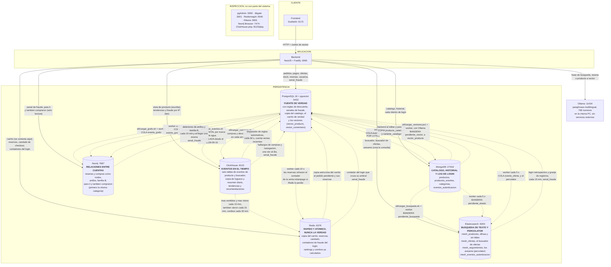

# Arquitectura de Mesh

**Al 2026-10-28.** Es el diagrama de arquitectura que pide el enunciado, y **no
es el ER**: el ER (`docs/diagrama-general.drawio`) dibuja las 93 tablas de
PostgreSQL y sus llaves y lo genera `python docs/generar-er.py` desde la base
viva; este dibuja los **seis** motores de persistencia, quien escribe en cada
uno y por donde viajan los datos entre ellos.

**El `.drawio` de arquitectura se rehizo el 2026-09-19 y se puso al dia el 2026-10-20** con
`python docs/generar-arquitectura.py`: seis motores, lo que hace el backend con
cada uno y las doce rutas de datos entre motores, numeradas y explicadas en su
leyenda. `--informe` saca la variante compacta que va en el Word, y `--grafo` el
dibujo del modelo de Neo4j. El anterior quedo como
`diagrama-arquitectura-2026-09-03.drawio`.

Se actualiza en cada entrega, porque las tres lo piden como entregable. El
historial de que entro y cuando esta al final.

Para el informe, la version editable y exportable esta en
`docs/diagrama-arquitectura.drawio`. La de aqui abajo es la misma, en Mermaid,
para poder leerla sin abrir nada.

---

## El diagrama



**Tres cosas que el dibujo dice y conviene leer despacio.**

**El buscador cuelga de MongoDB y no de PostgreSQL**, y es la decision del ETL
del buscador. Hay productos que solo existen en Mongo, los que publica un
vendedor desde el panel, y un indice armado con `FROM productos` los dejaria
fuera. El sintoma seria un producto que se vende y que el buscador jura que no
existe, sin ningun error.

**Cada proyeccion se refresca de una manera distinta, y no por capricho.** El
grafo va por cola (`evento_grafo`) porque una resena se edita y se borra. El
buscador va por bandera en el documento. Y los eventos van por marca de agua,
porque un logueo no se edita ni se borra nunca: basta preguntar por el mayor id
ya copiado. La forma la decide si el origen puede cambiar debajo.

**ClickHouse es la unica con flecha de ida y vuelta desde el backend.** Las otras
tres proyecciones solo se leen; en esta el backend tambien escribe, porque las
vistas de producto **nacen ahi** y no se derivan de nada.

---

## Los flujos del login, desde el 2026-09-10

Un intento de entrar, bueno o malo, sale del backend por **dos caminos a la
vez**, y los dos existen por razones distintas:

```
login -> MongoDB eventos_autenticacion -> worker cada 5 s -> Elasticsearch
         (cada intento, con su motivo)    (pendiente_elastic)  mesh_eventos_autenticacion

login -> Redis, tres contadores --- cruza un umbral ---> PostgreSQL senal_fraude
         (fallos por IP, fallos por cuenta,               (una fila por tipo y
          identificadores por IP)                          clave, suma detecciones)
```

**El primero es la historia, y es para investigar despues.** MongoDB guarda
cada intento. El worker lo copia a Elasticsearch con el mismo `_id`, asi que
copiar dos veces el mismo evento lo sobrescribe y no lo duplica; es la misma
forma de bandera en el documento que ya usa el buscador. El indice nace de una
**plantilla** (`elastic/002_eventos_autenticacion.json`) y no de un mapeo fijo,
porque el worker escribe con `index()`, que autocrea el indice, y el primer dia
nacio con `ip` de tipo texto.

**El segundo es la deteccion en el momento, y olvida.** Los contadores de Redis
viven 60 o 300 segundos: sirven para decir "esto esta pasando ahora" sin
consultar nada, en el mismo camino del login. Cuando uno cruza su umbral, lo
unico que queda es una senal en `senal_fraude`, en PostgreSQL, que es donde un
admin la revisa y la lee `GET /admin/fraude/alertas-login`. Hasta la migracion
033 era una fila por minuto en `alerta_fraude`; desde ahi es una sola por tipo y
clave, y cada vez que se vuelve a ver suma una deteccion.

**Quien lee `mesh_eventos_autenticacion`.** Desde el 2026-09-18 (10b8fe5 de Jose
David) el backend hace agregaciones `terms` y `cardinality` sobre ese indice:
el login retrospectivo y la toma de cuenta (`fraude-login-retrospectivo.service.ts`
y `toma-cuenta.service.ts`, cada 15 min), el viaje imposible y la exploracion de
eventos del panel de fraude. Lo que encuentran queda como senal en
`senal_fraude`, que es la flecha de Elasticsearch a PostgreSQL del diagrama.
Ademas lo mira Kibana, a mano:
tiene una vista de datos sobre `mesh_eventos_autenticacion` (campo de fecha
`fecha`) y otra sobre `mesh_productos`, que crea solo el contenedor
`mesh-kibana-vistas` al levantar. Kibana es una ventana de inspeccion y no forma
parte del flujo.

**Y la flecha de PostgreSQL a ClickHouse quedo sin agua, a proposito.** Copia
`log_login`, que desde el 2026-09-10 ya no recibe filas porque el log se mudo a
Mongo. El 2026-09-19 se decidio que ClickHouse ya no lleva los registros de login,
los lleva Elasticsearch, y la copia queda congelada (`etl/README.md`).

---

## Que hace cada motor, y por que ese y no otro

| Motor | Que guarda | Por que ahi |
|---|---|---|
| **PostgreSQL** | usuarios, direcciones, categorias, **ofertas**, `precio_historial`, pedidos (el `pendiente` de cada cuenta es su carrito), lineas, pagos, kardex, reservas de venta relampago, resenas, las senales de fraude y los vectores (pgvector) | Es lo que necesita transaccion. La compra entera es atomica y el descuento de stock va con `SELECT ... FOR UPDATE`. Entrega 1: cero sobreventas sobre 555 ofertas. Los vectores van aqui desde el 2026-10-16 (ADR-13, abajo) |
| **MongoDB** | el catalogo, su historial de eventos, y desde el 2026-09-10 el log de autenticacion | Los atributos varian por categoria: lo que describe una laptop no describe una camisa. Un esquema fijo serian columnas casi todas nulas. El historial es append de eventos, y se reconstruye el estado a una fecha |
| **Redis** | la copia rapida del carrito, la venta relampago, el candado de checkout y los contadores de fraude del login | Lo que tiene que contestar al instante y lo que tiene que ser atomico sin bloquear (`inventario_limitado.lua`). Desde el 2026-10-17 **nunca es la fuente de verdad** (pedido del profesor): el carrito y las reservas se copian a PostgreSQL, y si Redis se cae se compra contra PostgreSQL |
| **Neo4j** | el grafo de calificaciones, domicilios y, desde el 2026-10-16, compras | Preguntas de varios saltos y de largo variable: los anillos de fraude, "para ti" (lo que compraron quienes compraron lo mismo que tu) y "tambien compraron". El porque, con la comparativa contra columnar, en `docs/DECISION-GRAFOS-VS-COLUMNAR.md` |
| **Elasticsearch** | el indice del catalogo, el de ofertas, el percolator de los avisos y el de eventos de autenticacion | Escribir "labtop" y que encuentre "laptop", en productos y en ofertas. El percolator guarda CONSULTAS y les lanza cada oferta que cambia: es el "avisame cuando llegue". El de eventos agrupa los registros por IP (la granja de registros). Ver `elastic/README.md` |
| **ClickHouse** | los eventos: vistas de producto, logueos y registros | Tendencia y fraude sobre millones de filas con hora. Guarda por columna, y las preguntas se hacen despues con SQL. Ver `clickhouse/README.md` |

### La base columnar SI esta, desde el 2026-09-06, y llego por la puerta que el ADR dejo abierta

Hasta esa fecha aqui decia "la base columnar no esta, y es una decision". Era
cierto y estaba bien argumentado: `docs/DECISION-GRAFOS-VS-COLUMNAR.md` rechazo
Cassandra con dos numeros medidos, **32 pedidos** y una consulta de tendencias de
**16.4 ms** sobre los indices que ya existian. Meter un motor entero para bajar
de 16 ms a un numero mas chico que nadie nota habria sido decorar.

Lo que cambio no es la opinion, **es el dato**. El sistema empezo a guardar
eventos de navegacion, y ahi los dos numeros del ADR dejan de aplicar: un clic
por visita no se parece en nada a 32 pedidos. Eso es literalmente la condicion
**6.2** que ese mismo documento dejo escrita, "cuando el volumen de eventos
crezca dos ordenes de magnitud", y roza la 6.4, "cuando la escritura de eventos
sea el cuello de botella".

**Y el motor no es Cassandra, que era la opcion de referencia del enunciado.** Es
ClickHouse, y el enunciado lo permite en 5.2 como alternativa equivalente. La
razon es de una linea:

> Con Cassandra hay que saber la pregunta ANTES de guardar el dato. Con
> ClickHouse se guarda el evento una vez y se pregunta lo que sea despues.

Cassandra es wide-column: guarda agrupado por clave de particion y esta hecha
para leer por clave conocida. No sabe hacer `GROUP BY` entre particiones ni
ordenar fuera de la particion, asi que cada pregunta nueva es una tabla nueva mas
recargar todo el historico. Detectar fraude es, por definicion, encontrar lo que
no sabias que estabas buscando.

Lo bonito es que **una de las objeciones que el propio ADR levanto contra
Cassandra -- "tres tablas, cada una con su clave de particion" -- es justo la que
ClickHouse borra**. El analisis no se cae, apunta a otro sitio.

---

## Las tres reglas del reparto, que es lo que de verdad hay que saber

### 1. El producto vive en MongoDB, sus ofertas en PostgreSQL (ADR-2)

Es la decision que mas explica el resto del diagrama. Un producto describe una
cosa del mundo y **no es de nadie**; quien lo vende, a que precio y con cuanto
stock es una fila de `oferta`, en el relacional. La razon es el atomo: el
descuento de stock no puede vender dos veces la ultima unidad.

El documento de Mongo lleva **siete numeros agregados** -- `precio_tienda`,
`precio_desde`, `stock_tienda`, `stock_total`, `total_ofertas`,
`resenas_promedio` y `resenas_total` -- para que la tarjeta del catalogo no
tenga que preguntar por cada producto de la pagina. **Son una copia para pintar,
no la verdad.** Cuanto queda de verdad se pregunta en PostgreSQL.

### 2. Las dos flechas punteadas eran por lotes; la del grafo ya no

`etl/cargar.js` y `etl/cargar_grafo.sh` corren cuando alguien los corre. Asi
nacio la flecha hacia Neo4j, y una resena nueva no llegaba al grafo hasta la
siguiente corrida.

Desde el 2026-09-04 el grafo se mantiene solo: la migracion 015 encola cada
resena tocada en `evento_grafo` dentro de la misma transaccion (el outbox de
`docs/PENDIENTE-OUTBOX.md`), un worker del backend la vacia cada 10 s, y
`GET /admin/grafo/conciliacion` compara los cuatro conteos contra PostgreSQL.
El panel de fraude ensena esa conciliacion debajo de los anillos, en gris
cuando cuadra y en rojo cuando no.

La del catalogo sigue por lotes: la nota de Mongo no se mueve hasta que corre
`bash etl/correr.sh --notas`.

### 3. El ETL a Mongo agrega y actualiza, pero nunca borra

`etl/cargar.js` escribe con `replaceOne` y `upsert`. Su unico barrido de
sobrantes cubre `categorias` y `productos_eventos`: **para `db.productos` no hay
ninguno**, y es a proposito, porque un barrido se llevaria por delante a los
productos que nacieron en el panel de un vendedor y no tienen fila en
PostgreSQL.

La consecuencia hay que saberla: borrar productos en PostgreSQL **no** los quita
de Mongo, y el verificador del arranque no protesta porque compara con `-lt`
(solo se queja si Mongo tiene MENOS). Un fantasma se esconde exactamente en ese
hueco.

---

## Lo que este diagrama no esconde

**Hay dos repartidores de id de producto que no se hablan**, y una tercera
cuenta que no mira ninguno de los dos. El `bigserial` de `productos.id_producto`
en PostgreSQL, el maximo `_id` de Mongo que usa el panel del vendedor, y la
**secuencia**, que va por delante del maximo real. Medido el 2026-09-03: la
secuencia estaba en 1126 con el maximo en 1105, un hueco de 21. Esta entero en
el pendiente 5 de `docs/PENDIENTES.md`, que el 2026-09-19 quedo sin prioridad:
el arranque avisa si los dos se cruzan.

**Todo corre en una sola maquina**, en doce contenedores del mismo Docker: diez que se quedan corriendo (seis
motores y cuatro ventanas, pgAdmin, DbGate, RedisInsight y Kibana) y dos de un
solo uso, `mesh-kibana-vistas` y `mesh-elastic-usuarios`, que terminan en `Exited (0)`.
`mesh-ollama` es uno mas, opcional, que solo sube si la PC no tiene Ollama. Eso
importa para cualquier discusion sobre escalar: una base distribuida en un solo
nodo se queda con todos sus costes y ninguna de sus ventajas.

**El control de acceso esta en cinco de las seis bases** (ADR-14,
`docs/SEGURIDAD.md`). El backend entra como `mesh_backend` en PostgreSQL,
MongoDB, ClickHouse y Elasticsearch, y como `backend` en Redis (solo claves
`mesh:*`). Lee y escribe datos y nada mas, sin crear ni borrar tablas,
colecciones ni indices. Las ventanas de inspeccion entran con usuarios que solo
miran (`mesh_lectura` e `inspeccion`). Neo4j es la excepcion, porque su edicion
community no tiene roles. Redis tiene ACL desde el 2026-09-25 y las demas desde
el 2026-10-23. La prueba es `bash seguridad/prueba_acceso.sh`, 93 comprobaciones
bien y ninguna mal.

Eso es por SERVICIO. Dentro de la tienda hay dos capas mas, las dos en tablas
del mismo PostgreSQL, asi que no son flechas nuevas del dibujo:

- Por ROL, desde el 2026-10-28, el ACL de funcionalidades (ADR-26, migracion
  050): cada una de las 136 rutas privadas declara su accion (`@Permiso`) y
  `PermisoGuard` le pregunta a `rol_permiso` si el rol de la cuenta la tiene. Sin
  ella, 403, tambien llamando a la ruta directo. Antes era `@Roles` en el codigo.
- Por PERSONA, desde el 2026-10-26, el ACL de ofertas (ADR-24): `permiso_oferta`
  dice que cuenta puede ver, editar o poner descuento en que oferta, y
  `PermisoOfertaGuard` lo revisa antes de cada ruta de `/compartidas/ofertas`,
  despues del permiso del rol.

---

## Como se levanta todo esto

```powershell
.\arrancar.ps1                                  # contenedores, migraciones, semilla, ETL, vectores y usuarios
.\panel-comandos\servicios.ps1 -Accion backend  # compila y levanta :3000
.\panel-comandos\servicios.ps1 -Accion frontend # compila y levanta :5173
```

Con las bases en otra PC, `.\usar-bases-remotas.ps1 -Ip 100.x.y.z` antes de
levantar el backend (`remoto/README.md`). El detalle esta en
`docs/instalacion.md`.

---

## Historial de este diagrama

| Cuando | Que cambio |
|---|---|
| Entrega 1 | PostgreSQL y MongoDB, con el ETL del catalogo |
| **Entrega 2 (2026-09-03)** | Se suman **Redis** (carrito, venta relampago y candado de checkout) y **Neo4j** (grafo de fraude, con su ETL). Se decide **no** incorporar una base columnar |
| **Entrega 3 (2026-09-04)** | Entra **Elasticsearch** con su indice, su ETL, su cola con worker y sus dos rutas. Se escribe el documento de consistencia del checkout. **Falta** la faceta con agregaciones y la prueba de falla simulada |
| **2026-09-06** | Entra **ClickHouse**, la sexta base, con las tres tablas de eventos, su ETL incremental desde PostgreSQL y su generador de lotes. Cambia la decision de la Entrega 2 sobre la columnar, y el porque esta arriba |
| **2026-09-10 y 11** | El log de login se muda a **MongoDB** (`eventos_autenticacion`) y un worker lo copia a un segundo indice de **Elasticsearch**. Tres contadores de **Redis** dejan alertas en `alerta_fraude` de **PostgreSQL** (migracion 016). La copia de logueos a ClickHouse queda congelada. Ya esta en el Mermaid y en `docs/diagrama-arquitectura.drawio` y su `.png`, que se regeneraron ese dia con Kibana en la nota de herramientas de inspeccion |
| **2026-09-18 y 19** | Seis eventos de producto y buscador en ClickHouse, con su resumen diario y los rankings de tendencias. Un worker cada 10 minutos cachea lo mas vendido en un ZSET de Redis. El detector de anillos (cada 15 minutos) guarda en PostgreSQL lo que encuentra en Neo4j. `etl/cargar_compras.sh` copia compras y devoluciones a ClickHouse. El `.drawio` de arquitectura se rehizo entero y el ER se genera desde la base viva |
| **2026-09-20** | Entra **Kibana** 8.15.3, la misma version que Elasticsearch, como ventana de inspeccion (`127.0.0.1:5601`, tope de memoria de 1 GB), y el contenedor de un solo uso `mesh-kibana-vistas`, que crea sus dos vistas de datos en cada `docker compose up`. Solo en el Mermaid; el `.drawio` falta |
| **2026-09-24 y 25** | Reglas de descuento automaticas y por fecha en **PostgreSQL** (migraciones 021 y 022). El disparador de las automaticas cuenta ventas en **ClickHouse** cada 60 segundos y el vencimiento de cada descuento vive como clave con TTL en **Redis**. La familia B de patrones de resenas corre sobre **Neo4j** y guarda en `anillo_fraude` (migracion 023). Tendencias T1 a T3 y recomendaciones R1 a R3 salen de **ClickHouse**, y R2, R3 y lo mas visto quedan calculados en **Redis**. El `.drawio` y el Mermaid se pusieron al dia. La evaluacion de NewSQL para pagos esta en `DECISION-NEWSQL-PAGOS.md` (ADR-12 del registro unico) |
| **Entrega final (2026-09-25)** | Entra **pgvector** sobre el mismo PostgreSQL: `producto_vector` con indice HNSW y `productos_similares()` (migracion 024, reescrita en la 027 para que de verdad use el indice). Los vectores los calcula **Ollama** con `paraphrase-multilingual` desde el texto de **MongoDB** (`etl/cargar_vectores.ps1`, flujo 11). Ollama es el de la PC si lo tiene o el contenedor `mesh-ollama`, que solo se levanta si hace falta. **Redis** pasa de una contrasena sola a tres usuarios de ACL (cuatro desde el 2026-10-23) |
| **2026-09-30** | El refactor de fraude que pidio el profesor (7453ffe de Jose David, migraciones 031 a 033). Los tres detectores, Neo4j, ClickHouse y el login, guardan en una sola tabla, `senal_fraude`, una fila por tipo y clave con sus cuentas, resenas, productos, pedidos e IP. Los casos y los avisos al usuario cuelgan de la senal. `anillo_fraude`, `hallazgo_evento_fraude` y `alerta_fraude` quedan sin escrituras. Solo el Mermaid y el `.drawio` cambian de nombre de tabla; no hay flecha nueva |
| **2026-10-01** | Comprar sin MongoDB, del diseno de Jose David (6f89237, migraciones 029 y 030). El nombre, el estado y la portada de cada variante se copian a **PostgreSQL** (`producto_catalogo` y `variante_catalogo`), y el recalculo del catalogo en **MongoDB** va por la cola `evento_producto` con un worker. El checkout ya solo necesita PostgreSQL y Redis; medido con MongoDB parado en `pruebas/falla_checkout.sh` |
| **2026-10-02 y 04** | Los vectores se mudan de **pgvector** a **Elasticsearch** (fa3281c de Jose David; la migracion 036 retira `producto_vector` y `productos_similares()`). El de cada producto va en su documento de `mesh_productos` y los parecidos salen de un kNN; el de cada resena va en el indice nuevo `mesh_comentarios`, que llena la cola `evento_comentario` (migracion 034) con un worker. Del texto de las resenas salen dos senales de fraude nuevas, `resenas_repetidas` y `anillo_de_texto` (035), y la busqueda por intencion. La 037 deja el tipo `nota_no_cuadra` para el clasificador de resenas. `mesh_comentarios` lleva el vector en `flat` y no en HNSW: con resenas repetidas el grafo HNSW no encontraba las mejores (medido en `docs/BACKEND-PENDIENTE.md`) |
| **2026-10-04, tarde** | Lo de 3305cf3 y 1f1f480 de Jose David. Las notas incoherentes (el clasificador de reseñas dice si un texto es malo; migración 037) y las reseñas parecidas (038) salen de **Elasticsearch**; las reseñas con la compra cancelada salen de **PostgreSQL**, con la fuente nueva `postgres` (039). Las señales de texto y la de cancelación se revisan al momento, no solo cada 15 minutos. El buscador gana la búsqueda **híbrida** (palabras y significado en una lista, por posición) y el "tal vez quisiste decir", y proponer un producto sugiere categoría y parecidos con el vector |
| **2026-10-16 y 17** | Lo de 25f0fe0 de Jose David, a pedido del profesor (migraciones 040 a 045). **Todos los vectores vuelven a PostgreSQL** con pgvector: `vector_producto` y `vector_comentario`, con indice HNSW; `mesh_comentarios` y los campos de vector de `mesh_productos` se retiran (040). Las **compras pasan al grafo** como nodos `:Compra`, por la cola `evento_grafo_compra`, y "para ti" y "tambien compraron" se leen de **Neo4j** en vivo; `ParaTiSyncService` se borra (041). La limpieza de fraude quita `cadena_abierta`, `favor_devuelto` (ahora un bono de `mutuo`) y `carrito_acaparador`, la granja de registros sale de **Elasticsearch** y una senal de login ya no une casos (042). **Elasticsearch** gana el buscador de ofertas (`mesh_ofertas`, cola `evento_oferta`, 043) y el percolator de los "avisame" (`mesh_seguimientos`, 044). **Redis nunca es la fuente de verdad**: el carrito es el pedido `pendiente` de PostgreSQL y las reservas de venta relampago viven en `reserva_venta_relampago` (045). **ClickHouse** suma los combos (cada 30 min a Redis) y las busquedas sin resultados (`termino_normalizado`) |
| **2026-10-19 y 20** | Lo que pidio el profesor, que la tienda siga con una base apagada. Cada base tiene un cortacircuitos (`backend/src/helpers/cortacircuitos.ts`) y lo que daba sale de otra. Sin **MongoDB**, el catalogo y la ficha salen de la copia en **PostgreSQL** (047). Sin **Redis**, los rankings se calculan en el momento en **ClickHouse** y las ofertas destacadas en **PostgreSQL**. Sin **Elasticsearch**, el buscador busca en la copia del catalogo con la misma regla de texto (048). Sin **Neo4j**, para ti y tambien compraron salen de los pedidos en **PostgreSQL**. Sin **PostgreSQL**, la sesion abierta sigue por su token y el perfil copiado en **Redis**, y no se paga. Las facetas de **Elasticsearch** filtran en la consulta y no en `post_filter`. El detalle por base esta en `docs/QUE-PASA-SI-SE-CAE-UNA-BASE.md`. No hay flechas nuevas de datos en el dibujo, solo lecturas de respaldo |
| **2026-10-20, tarde** | El `.drawio` y su PNG se ponen al dia con lo de octubre: vectores en PostgreSQL, compras en Neo4j, buscador de ofertas y avisame en Elasticsearch, combos en ClickHouse y Redis, reservas de venta relampago que rehacen el contador de Redis. Sale la flecha del descuento con TTL en Redis, que desde la migracion 028 (2026-09-26) es una columna de PostgreSQL. 86 tablas y 107 llaves foraneas |
| **2026-10-23** | **Control de acceso en todas las bases** (ADR-14, `docs/SEGURIDAD.md`): un `mesh_backend` que solo lee y escribe datos y un `mesh_lectura` en **PostgreSQL**, **MongoDB**, **ClickHouse** y **Elasticsearch**, que enciende su seguridad; en **Redis** el backend pasa a su usuario `backend`, solo claves `mesh:*`. **Neo4j** community no tiene roles. Los crea el paso 9f de arrancar y los prueba `seguridad/prueba_acceso.sh` (93 OK). Herramientas solo en 127.0.0.1 e imagenes con version fija. El documento de **Elasticsearch** guarda la foto de la tarjeta (`imagen`, sin indexar, ADR-23). Registro unico de decisiones ADR-1 a ADR-23 en `docs/DECISIONES.md`. El diagrama suma la caja de Ollama, el usuario de cada base y el recuadro del modo remoto |
| **2026-10-26** | **Neo4j** guarda la categoria en cada `:Producto` (`id_categoria` y `categoria`, de `producto_catalogo`), y quienes lo compraron tambien llevaron pone primero, como grupo, los de la misma categoria (ADR-25). La escriben los workers de compras y de resenas y el ETL, y un worker nuevo la compara con **PostgreSQL** cada minuto (flecha nueva, PG a N4). **PostgreSQL** suma el ACL de la aplicacion por oferta, `permiso_oferta` y su registro (migracion 049, ADR-24) |
| **2026-10-28** | **PostgreSQL** suma el ACL de funcionalidades por rol (migracion 050, ADR-26): `modulo_permiso`, `permiso`, `rol_permiso` y `auditoria_permiso`, y la vista `permisos_por_rol`. `PermisoGuard` lo revisa en las 136 rutas privadas y reemplaza a los `@Roles` del codigo, con los mismos roles por ruta el primer dia. 93 tablas |

El `pgvector` de la Entrega final **venia en la imagen desde la Entrega 1**: el
compose usa `pgvector/pgvector:pg18` y no el `postgres` a secas. Cuando toco no
hubo que cambiar de imagen, la migracion 024 solo crea la extension. Del
2026-10-04 al 10-16 no se uso (la 036 quito la tabla y la funcion), y la imagen
se quedo por eso: cambiarla toca el volumen de datos. Desde la 040 se vuelve a
usar.

**ADR-13, los vectores en PostgreSQL, segunda vez.** Paso por tres lugares:

| Desde | Donde | Por que |
|---|---|---|
| 2026-09-25 | `producto_vector` en PostgreSQL (024, 027) | La recomendacion semantica de la Entrega final |
| 2026-10-02 | el documento de `mesh_productos` y el indice `mesh_comentarios` de Elasticsearch (036) | El vector vivia junto al nombre, el estado y las facetas, y una sola consulta kNN los combinaba |
| 2026-10-16 | `vector_producto` y `vector_comentario` en PostgreSQL (040) | Lo pidio el profesor: las consultas por vectores con pgvector. Y se midio que gana en exactitud |

Lo que decidio la vuelta, medido por Jose David con el mismo catalogo
(`backend/cambio_propuestas/2026-10-16_2100-vectores-a-pgvector.md`): los
similares de los 1103 productos contra el coseno exacto calculado aparte dan
**1000 de 1001 iguales** con pgvector (el otro es un empate a 4e-8) y **317**
con Elasticsearch, cuyo indice `int8_hnsw` cuantiza los vectores con errores de
hasta 0,016. Los cuatro detectores de fraude por texto dieron **exactamente** las
mismas senales con los mismos vectores. Y la comparacion de todas las resenas
contra todas, que antes traia los vectores a Node, ahora la hace PostgreSQL sin
que los vectores salgan de la base.

Por que tablas aparte y no columnas: los triggers de `comentario` encolan cada
cambio del texto, y si el worker escribiera el vector en la misma fila se
encolaria solo; un vector pesa unos 3 KB y haria mas pesada cada lectura de
resenas; y "sin vector" es no tener fila. El nombre no es `producto_vector`
porque la 036 lo borra en cada arranque. Lo que se pierde respecto a
Elasticsearch es combinar el vector con el texto en una consulta: la hibrida
pide las palabras a Elasticsearch y el significado a PostgreSQL, y las junta
por posicion.
