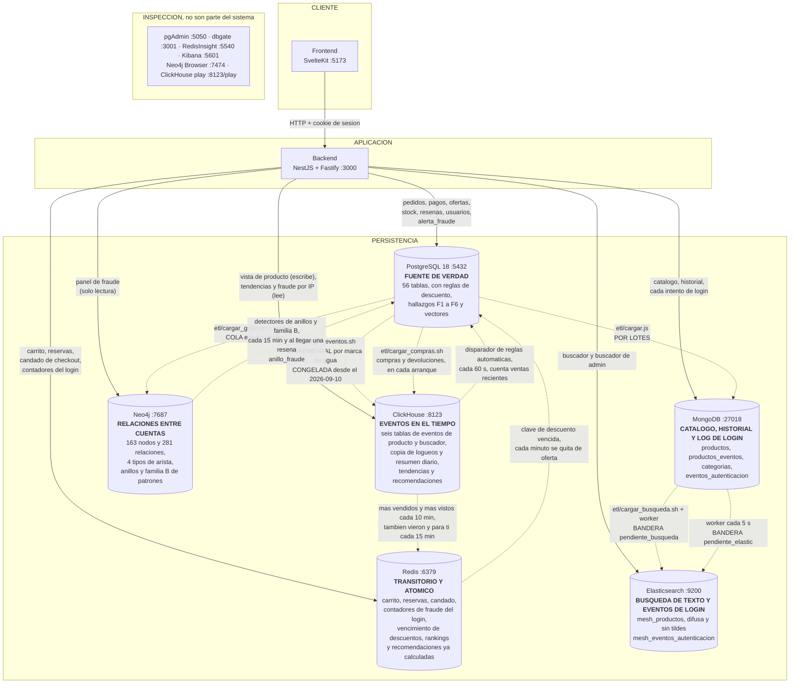

# Arquitectura de Mesh

**Al 2026-09-20.** Es el diagrama de arquitectura que pide el enunciado, y **no
es el ER**: el ER (`docs/diagrama-general.drawio`) dibuja las 50 tablas de
PostgreSQL y sus llaves y lo genera `python docs/generar-er.py` desde la base
viva; este dibuja los **seis** motores de persistencia, quien escribe en cada
uno y por donde viajan los datos entre ellos.

**El `.drawio` de arquitectura se rehizo el 2026-09-19** con
`python docs/generar-arquitectura.py`: seis motores, lo que hace el backend con
cada uno y las ocho rutas de datos entre motores, numeradas y explicadas en su
leyenda. `--informe` saca la variante compacta que va en el Word, y `--grafo` el
dibujo del modelo de Neo4j. El anterior quedo como
`diagrama-arquitectura-2026-09-03.drawio`.

Se actualiza en cada entrega, porque las tres lo piden como entregable. El
historial de que entro y cuando esta al final.

Para el informe, la version editable y exportable esta en
`docs/diagrama-arquitectura.drawio`. La de aqui abajo es la misma, en Mermaid,
para poder leerla sin abrir nada.

---

## El diagrama



**Tres cosas que el dibujo dice y conviene leer despacio.**

**El buscador cuelga de MongoDB y no de PostgreSQL**, y es la decision del ETL
del buscador. Hay productos que solo existen en Mongo, los que publica un
vendedor desde el panel, y un indice armado con `FROM productos` los dejaria
fuera. El sintoma seria un producto que se vende y que el buscador jura que no
existe, sin ningun error.

**Cada proyeccion se refresca de una manera distinta, y no por capricho.** El
grafo va por cola (`evento_grafo`) porque una resena se edita y se borra. El
buscador va por bandera en el documento. Y los eventos van por marca de agua,
porque un logueo no se edita ni se borra nunca: basta preguntar por el mayor id
ya copiado. La forma la decide si el origen puede cambiar debajo.

**ClickHouse es la unica con flecha de ida y vuelta desde el backend.** Las otras
tres proyecciones solo se leen; en esta el backend tambien escribe, porque las
vistas de producto **nacen ahi** y no se derivan de nada.

---

## Los flujos del login, desde el 2026-09-10

Un intento de entrar, bueno o malo, sale del backend por **dos caminos a la
vez**, y los dos existen por razones distintas:

```
login -> MongoDB eventos_autenticacion -> worker cada 5 s -> Elasticsearch
         (cada intento, con su motivo)    (pendiente_elastic)  mesh_eventos_autenticacion

login -> Redis, tres contadores --- cruza un umbral ---> PostgreSQL alerta_fraude
         (fallos por IP, fallos por cuenta,               (UPSERT por tipo, clave
          identificadores por IP)                          y minuto)
```

**El primero es la historia, y es para investigar despues.** MongoDB guarda
cada intento. El worker lo copia a Elasticsearch con el mismo `_id`, asi que
copiar dos veces el mismo evento lo sobrescribe y no lo duplica; es la misma
forma de bandera en el documento que ya usa el buscador. El indice nace de una
**plantilla** (`elastic/002_eventos_autenticacion.json`) y no de un mapeo fijo,
porque el worker escribe con `index()`, que autocrea el indice, y el primer dia
nacio con `ip` de tipo texto.

**El segundo es la deteccion en el momento, y olvida.** Los contadores de Redis
viven 60 o 300 segundos: sirven para decir "esto esta pasando ahora" sin
consultar nada, en el mismo camino del login. Cuando uno cruza su umbral, lo
unico que queda es una fila en `alerta_fraude`, en PostgreSQL, que es donde un
admin la revisa y la lee `GET /admin/fraude/alertas-login`.

**Una flecha que falta a proposito: ninguna ruta lee `mesh_eventos_autenticacion`.**
El indice se llena y nadie lo consulta; las rutas de agregacion son de
`backend/` y estan en `docs/BACKEND-PENDIENTE.md`. Por eso la flecha del
backend a Elasticsearch solo dice "buscador". Lo que si lo mira es Kibana, a mano:
tiene una vista de datos sobre `mesh_eventos_autenticacion` (campo de fecha
`fecha`) y otra sobre `mesh_productos`, que crea solo el contenedor
`mesh-kibana-vistas` al levantar. Kibana es una ventana de inspeccion y no forma
parte del flujo.

**Y la flecha de PostgreSQL a ClickHouse quedo sin agua.** Copia `log_login`,
que desde el 2026-09-10 ya no recibe filas porque el log se mudo a Mongo. Esta
en `etl/README.md`, y que hacer con ella se decide con el profesor.

---

## Que hace cada motor, y por que ese y no otro

| Motor | Que guarda | Por que ahi |
|---|---|---|
| **PostgreSQL** | usuarios, direcciones, categorias, **ofertas**, `precio_historial`, pedidos, lineas, pagos, kardex, resenas y las alertas de fraude del login | Es lo que necesita transaccion. La compra entera es atomica y el descuento de stock va con `SELECT ... FOR UPDATE`. Entrega 1: cero sobreventas sobre 555 ofertas |
| **MongoDB** | el catalogo, su historial de eventos, y desde el 2026-09-10 el log de autenticacion | Los atributos varian por categoria: lo que describe una laptop no describe una camisa. Un esquema fijo serian columnas casi todas nulas. El historial es append de eventos, y se reconstruye el estado a una fecha |
| **Redis** | carrito, venta relampago, candado de checkout y los contadores de fraude del login | Lo transitorio (el carrito vence solo por inactividad, un contador de fallos a los 60 s) y lo que tiene que ser atomico sin bloquear (`inventario_limitado.lua`) |
| **Neo4j** | el grafo de calificaciones y domicilios | Preguntas de varios saltos y de largo variable. El porque, con la comparativa contra columnar, en `docs/DECISION-GRAFOS-VS-COLUMNAR.md` |
| **Elasticsearch** | el indice del catalogo y el de eventos de autenticacion | Escribir "labtop" y que encuentre "laptop". El `$text` de Mongo Community no tiene difusa, y la Entrega 3 pide el motor dedicado. El de eventos es para agregar por IP y por cuenta, y todavia no lo lee ninguna ruta. Ver `elastic/README.md` |
| **ClickHouse** | los eventos: vistas de producto, logueos y registros | Tendencia y fraude sobre millones de filas con hora. Guarda por columna, y las preguntas se hacen despues con SQL. Ver `clickhouse/README.md` |

### La base columnar SI esta, desde el 2026-09-06, y llego por la puerta que el ADR dejo abierta

Hasta esa fecha aqui decia "la base columnar no esta, y es una decision". Era
cierto y estaba bien argumentado: `docs/DECISION-GRAFOS-VS-COLUMNAR.md` rechazo
Cassandra con dos numeros medidos, **32 pedidos** y una consulta de tendencias de
**16.4 ms** sobre los indices que ya existian. Meter un motor entero para bajar
de 16 ms a un numero mas chico que nadie nota habria sido decorar.

Lo que cambio no es la opinion, **es el dato**. El sistema empezo a guardar
eventos de navegacion, y ahi los dos numeros del ADR dejan de aplicar: un clic
por visita no se parece en nada a 32 pedidos. Eso es literalmente la condicion
**6.2** que ese mismo documento dejo escrita, "cuando el volumen de eventos
crezca dos ordenes de magnitud", y roza la 6.4, "cuando la escritura de eventos
sea el cuello de botella".

**Y el motor no es Cassandra, que era la opcion de referencia del enunciado.** Es
ClickHouse, y el enunciado lo permite en 5.2 como alternativa equivalente. La
razon es de una linea:

> Con Cassandra hay que saber la pregunta ANTES de guardar el dato. Con
> ClickHouse se guarda el evento una vez y se pregunta lo que sea despues.

Cassandra es wide-column: guarda agrupado por clave de particion y esta hecha
para leer por clave conocida. No sabe hacer `GROUP BY` entre particiones ni
ordenar fuera de la particion, asi que cada pregunta nueva es una tabla nueva mas
recargar todo el historico. Detectar fraude es, por definicion, encontrar lo que
no sabias que estabas buscando.

Lo bonito es que **una de las objeciones que el propio ADR levanto contra
Cassandra -- "tres tablas, cada una con su clave de particion" -- es justo la que
ClickHouse borra**. El analisis no se cae, apunta a otro sitio.

---

## Las tres reglas del reparto, que es lo que de verdad hay que saber

### 1. El producto vive en MongoDB, sus ofertas en PostgreSQL (ADR-2)

Es la decision que mas explica el resto del diagrama. Un producto describe una
cosa del mundo y **no es de nadie**; quien lo vende, a que precio y con cuanto
stock es una fila de `oferta`, en el relacional. La razon es el atomo: el
descuento de stock no puede vender dos veces la ultima unidad.

El documento de Mongo lleva **siete numeros agregados** -- `precio_tienda`,
`precio_desde`, `stock_tienda`, `stock_total`, `total_ofertas`,
`resenas_promedio` y `resenas_total` -- para que la tarjeta del catalogo no
tenga que preguntar por cada producto de la pagina. **Son una copia para pintar,
no la verdad.** Cuanto queda de verdad se pregunta en PostgreSQL.

### 2. Las dos flechas punteadas eran por lotes; la del grafo ya no

`etl/cargar.js` y `etl/cargar_grafo.sh` corren cuando alguien los corre. Asi
nacio la flecha hacia Neo4j, y una resena nueva no llegaba al grafo hasta la
siguiente corrida.

Desde el 2026-09-04 el grafo se mantiene solo: la migracion 015 encola cada
resena tocada en `evento_grafo` dentro de la misma transaccion (el outbox de
`docs/PENDIENTE-OUTBOX.md`), un worker del backend la vacia cada 10 s, y
`GET /admin/grafo/conciliacion` compara los cuatro conteos contra PostgreSQL.
El panel de fraude ensena esa conciliacion debajo de los anillos, en gris
cuando cuadra y en rojo cuando no.

La del catalogo sigue por lotes: la nota de Mongo no se mueve hasta que corre
`bash etl/correr.sh --notas`.

### 3. El ETL a Mongo agrega y actualiza, pero nunca borra

`etl/cargar.js` escribe con `replaceOne` y `upsert`. Su unico barrido de
sobrantes cubre `categorias` y `productos_eventos`: **para `db.productos` no hay
ninguno**, y es a proposito, porque un barrido se llevaria por delante a los
productos que nacieron en el panel de un vendedor y no tienen fila en
PostgreSQL.

La consecuencia hay que saberla: borrar productos en PostgreSQL **no** los quita
de Mongo, y el verificador del arranque no protesta porque compara con `-lt`
(solo se queja si Mongo tiene MENOS). Un fantasma se esconde exactamente en ese
hueco.

---

## Lo que este diagrama no esconde

**Hay dos repartidores de id de producto que no se hablan**, y una tercera
cuenta que no mira ninguno de los dos. El `bigserial` de `productos.id_producto`
en PostgreSQL, el maximo `_id` de Mongo que usa el panel del vendedor, y la
**secuencia**, que va por delante del maximo real. Medido el 2026-09-03: la
secuencia estaba en 1126 con el maximo en 1105, un hueco de 21. Esta entero en
el pendiente 5 de `docs/PENDIENTES.md`.

**Todo corre en una sola maquina**, en once contenedores del mismo Docker: diez que se quedan corriendo (seis
motores y cuatro ventanas, pgAdmin, DbGate, RedisInsight y Kibana) y uno de un
solo uso, `mesh-kibana-vistas`, que termina en `Exited (0)`. Eso
importa para cualquier discusion sobre escalar: una base distribuida en un solo
nodo se queda con todos sus costes y ninguna de sus ventajas.

**El control de acceso esta configurado en Redis y solo en Redis.** Tres usuarios
de ACL (el backend, RedisInsight y mantenimiento), cada uno con lo justo, y la
prueba `bash redis/prueba_acceso.sh`. Las otras bases NoSQL siguen con un solo
usuario de arranque. El enunciado pide al menos un componente, y Redis se
eligio porque es el que mas servicios tocan a la vez.

---

## Como se levanta todo esto

```powershell
.\arrancar.ps1              # los 11 contenedores, migraciones, semilla y ETL
```

Y despues, en dos terminales:

```
cd backend  ; npm run start:dev     # :3000
cd frontend ; npm run dev           # :5173
```

El detalle, con las trampas del entorno, esta en `docs/TRASPASO.md`.

---

## Historial de este diagrama

| Cuando | Que cambio |
|---|---|
| Entrega 1 | PostgreSQL y MongoDB, con el ETL del catalogo |
| **Entrega 2 (2026-09-03)** | Se suman **Redis** (carrito, venta relampago y candado de checkout) y **Neo4j** (grafo de fraude, con su ETL). Se decide **no** incorporar una base columnar |
| **Entrega 3 (2026-09-04)** | Entra **Elasticsearch** con su indice, su ETL, su cola con worker y sus dos rutas. Se escribe el documento de consistencia del checkout. **Falta** la faceta con agregaciones y la prueba de falla simulada |
| **2026-09-06** | Entra **ClickHouse**, la sexta base, con las tres tablas de eventos, su ETL incremental desde PostgreSQL y su generador de lotes. Cambia la decision de la Entrega 2 sobre la columnar, y el porque esta arriba |
| **2026-09-10 y 11** | El log de login se muda a **MongoDB** (`eventos_autenticacion`) y un worker lo copia a un segundo indice de **Elasticsearch**. Tres contadores de **Redis** dejan alertas en `alerta_fraude` de **PostgreSQL** (migracion 016). La copia de logueos a ClickHouse queda congelada. Ya esta en el Mermaid y en `docs/diagrama-arquitectura.drawio` y su `.png`, que se regeneraron ese dia con Kibana en la nota de herramientas de inspeccion |
| **2026-09-18 y 19** | Seis eventos de producto y buscador en ClickHouse, con su resumen diario y los rankings de tendencias. Un worker cada 10 minutos cachea lo mas vendido en un ZSET de Redis. El detector de anillos (cada 15 minutos) guarda en PostgreSQL lo que encuentra en Neo4j. `etl/cargar_compras.sh` copia compras y devoluciones a ClickHouse. El `.drawio` de arquitectura se rehizo entero y el ER se genera desde la base viva |
| **2026-09-20** | Entra **Kibana** 8.15.3, la misma version que Elasticsearch, como ventana de inspeccion (`127.0.0.1:5601`, tope de memoria de 1 GB), y el contenedor de un solo uso `mesh-kibana-vistas`, que crea sus dos vistas de datos en cada `docker compose up`. Solo en el Mermaid; el `.drawio` falta |
| **2026-09-24 y 25** | Reglas de descuento automaticas y por fecha en **PostgreSQL** (migraciones 021 y 022). El disparador de las automaticas cuenta ventas en **ClickHouse** cada 60 segundos y el vencimiento de cada descuento vive como clave con TTL en **Redis**. La familia B de patrones de resenas corre sobre **Neo4j** y guarda en `anillo_fraude` (migracion 023). Tendencias T1 a T3 y recomendaciones R1 a R3 salen de **ClickHouse**, y R2, R3 y lo mas visto quedan calculados en **Redis**. El `.drawio` y el Mermaid se pusieron al dia. La evaluacion de NewSQL para pagos esta en `DECISION-NEWSQL-PAGOS.md` (ADR-8) |
| **Entrega final (2026-09-25)** | Entra **pgvector** sobre el mismo PostgreSQL: `producto_vector` con indice HNSW y `productos_similares()` (migracion 024, reescrita en la 027 para que de verdad use el indice). Los vectores los calcula **Ollama** con `paraphrase-multilingual` desde el texto de **MongoDB** (`etl/cargar_vectores.ps1`, flujo 11). Ollama es el de la PC si lo tiene o el contenedor `mesh-ollama`, que solo se levanta si hace falta. **Redis** pasa de una contrasena sola a tres usuarios de ACL |

El `pgvector` de la Entrega final **venia en la imagen desde la Entrega 1**: el
compose usa `pgvector/pgvector:pg18` y no el `postgres` a secas. Cuando toco no
hubo que cambiar de imagen, la migracion 024 solo crea la extension.
