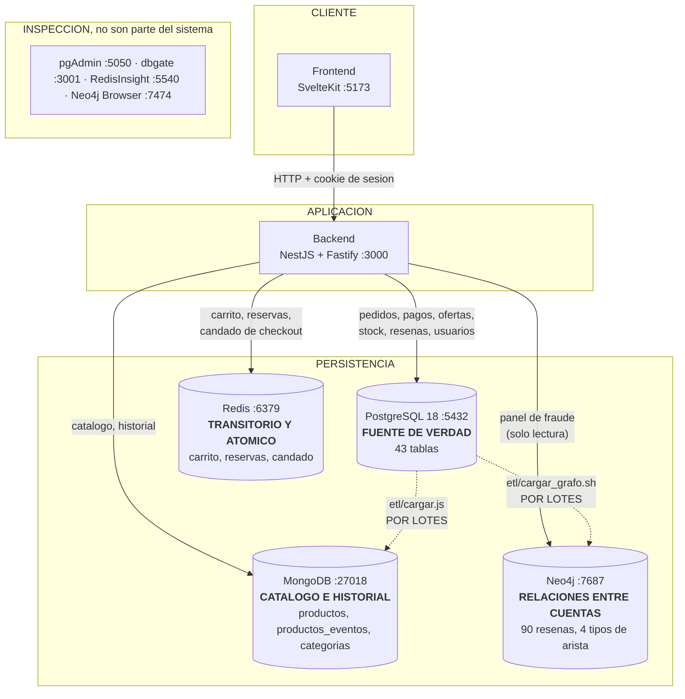

# Arquitectura de Mesh, al cierre de la Entrega 2

**Al 2026-09-03.** Es el diagrama de arquitectura que pide el enunciado, y **no
es el ER**: el ER (`docs/diagrama-general.drawio`) dibuja las 42 tablas de
PostgreSQL y sus llaves; este dibuja los cuatro motores de persistencia, quien
escribe en cada uno y por donde viajan los datos entre ellos.

Para el informe, la version editable y exportable esta en
`docs/diagrama-arquitectura.drawio`. La de aqui abajo es la misma, en Mermaid,
para poder leerla sin abrir nada.

---

## El diagrama



---

## Que hace cada motor, y por que ese y no otro

| Motor | Que guarda | Por que ahi |
|---|---|---|
| **PostgreSQL** | usuarios, direcciones, categorias, **ofertas**, `precio_historial`, pedidos, lineas, pagos, kardex y resenas | Es lo que necesita transaccion. La compra entera es atomica y el descuento de stock va con `SELECT ... FOR UPDATE`. Entrega 1: cero sobreventas sobre 555 ofertas |
| **MongoDB** | el catalogo y su historial de eventos | Los atributos varian por categoria: lo que describe una laptop no describe una camisa. Un esquema fijo serian columnas casi todas nulas. El historial es append de eventos, y se reconstruye el estado a una fecha |
| **Redis** | carrito, venta relampago y candado de checkout | Lo transitorio (el carrito vence solo por inactividad) y lo que tiene que ser atomico sin bloquear (`inventario_limitado.lua`) |
| **Neo4j** | el grafo de calificaciones y domicilios | Preguntas de varios saltos y de largo variable. El porque, con la comparativa contra columnar, en `docs/DECISION-GRAFOS-VS-COLUMNAR.md` |

### La base columnar no esta, y es una decision

No hay Cassandra. El panel de tendencias de venta se queda en PostgreSQL, y la
consulta de agregacion por mes y producto tarda **16.4 ms medidos** con los
indices que ya existen. El analisis completo, con las cinco condiciones bajo las
cuales SI habria que incorporarla, esta en `docs/DECISION-GRAFOS-VS-COLUMNAR.md`.

---

## Las tres reglas del reparto, que es lo que de verdad hay que saber

### 1. El producto vive en MongoDB, sus ofertas en PostgreSQL (ADR-2)

Es la decision que mas explica el resto del diagrama. Un producto describe una
cosa del mundo y **no es de nadie**; quien lo vende, a que precio y con cuanto
stock es una fila de `oferta`, en el relacional. La razon es el atomo: el
descuento de stock no puede vender dos veces la ultima unidad.

El documento de Mongo lleva **siete numeros agregados** -- `precio_tienda`,
`precio_desde`, `stock_tienda`, `stock_total`, `total_ofertas`,
`resenas_promedio` y `resenas_total` -- para que la tarjeta del catalogo no
tenga que preguntar por cada producto de la pagina. **Son una copia para pintar,
no la verdad.** Cuanto queda de verdad se pregunta en PostgreSQL.

### 2. Las dos flechas punteadas son por lotes, no continuas

`etl/cargar.js` y `etl/cargar_grafo.sh` corren cuando alguien los corre. Una
resena nueva no llega a Neo4j hasta entonces, y **el panel de fraude no avisa de
que esta mirando datos viejos**. Es el pendiente 4 y esta escrito entero en
`docs/PENDIENTE-OUTBOX.md`; la salida es un outbox transaccional, que ademas es
la respuesta al documento de consistencia de la Entrega 3.

Lo mas barato que mejora esto hoy son cuatro `count` de conciliacion que comparen
PostgreSQL contra Neo4j y avisen.

### 3. El ETL a Mongo agrega y actualiza, pero nunca borra

`etl/cargar.js` escribe con `replaceOne` y `upsert`. Su unico barrido de
sobrantes cubre `categorias` y `productos_eventos`: **para `db.productos` no hay
ninguno**, y es a proposito, porque un barrido se llevaria por delante a los
productos que nacieron en el panel de un vendedor y no tienen fila en
PostgreSQL.

La consecuencia hay que saberla: borrar productos en PostgreSQL **no** los quita
de Mongo, y el verificador del arranque no protesta porque compara con `-lt`
(solo se queja si Mongo tiene MENOS). Un fantasma se esconde exactamente en ese
hueco.

---

## Lo que este diagrama no esconde

**Hay dos repartidores de id de producto que no se hablan**, y una tercera
cuenta que no mira ninguno de los dos. El `bigserial` de `productos.id_producto`
en PostgreSQL, el maximo `_id` de Mongo que usa el panel del vendedor, y la
**secuencia**, que va por delante del maximo real. Medido el 2026-09-03: la
secuencia estaba en 1126 con el maximo en 1105, un hueco de 21. Esta entero en
el pendiente 5 de `docs/PENDIENTES.md`.

**Todo corre en una sola maquina**, en siete contenedores del mismo Docker. Eso
importa para cualquier discusion sobre escalar: una base distribuida en un solo
nodo se queda con todos sus costes y ninguna de sus ventajas.

**El control de acceso todavia no esta configurado** en los componentes NoSQL
mas alla del usuario y contrasena de arranque. Es de la Entrega final y esta
anotado como tal.

---

## Como se levanta todo esto

```powershell
.\arrancar.ps1              # los 7 contenedores, migraciones, semilla y ETL
```

Y despues, en dos terminales:

```
cd backend  ; npm run start:dev     # :3000
cd frontend ; npm run dev           # :5173
```

El detalle, con las trampas del entorno, esta en `docs/TRASPASO.md`.

---

## Historial de este diagrama

| Cuando | Que cambio |
|---|---|
| Entrega 1 | PostgreSQL y MongoDB, con el ETL del catalogo |
| **Entrega 2 (2026-09-03)** | Se suman **Redis** (carrito, venta relampago y candado de checkout) y **Neo4j** (grafo de fraude, con su ETL). Se decide **no** incorporar una base columnar |
| Entrega 3 | entrara el motor de busqueda, y el documento de consistencia del checkout |
| Entrega final | entrara el componente vectorial y el control de acceso |
